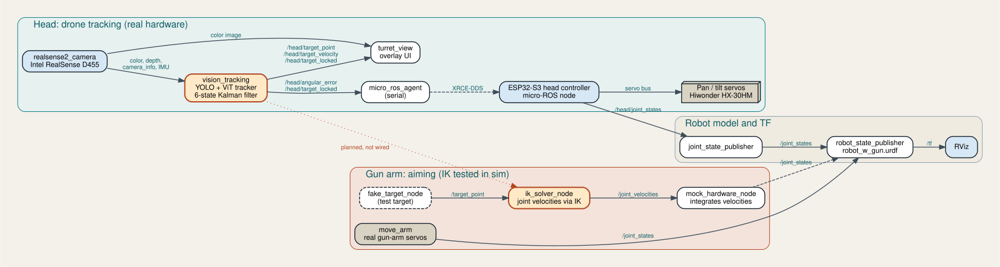

# OrexBot

ROS 2 (Jazzy) system for a turret robot that tracks a drone and aims at it.
A RealSense camera feeds a YOLO + ViT tracker, an ESP32 drives the pan/tilt head over micro-ROS,
and a Jacobian-based IK controller aims a 3-DOF arm at a 3D target.



## What it does

| Package | Language | What it does |
|---|---|---|
| `orex_head_vision` | Python | `vision_node`: YOLO detection, then ViT tracking, then a 6-state Kalman filter that coasts through brief detection loss. Fuses RealSense depth and IMU gyro to cancel the camera's own motion, and publishes `/head/angular_error` and `/head/target_locked`. `turret_view` is an optional HUD overlay. |
| `orex_head_control` | C++ (PlatformIO) | ESP32-S3 micro-ROS firmware. Subscribes to the angular error and drives the pan/tilt Hiwonder HX-30HM servos. |
| `orex_sim` | Python | `ik_math`: PD controller on the aim error (cross product of current vs. desired barrel direction) and a 3x3 Jacobian built from TF2, giving joint velocities for the gun arm. `mock_hardware` integrates those velocities so the IK can be tested in RViz with no hardware. `test_target` publishes a fake moving target. |
| `orex_arm_interface` | Python | `move_arm`: bridges the real gun-arm servos and ROS. Reads servo positions over a serial bus driver (`hiwonder_bus.py`), converts steps to radians with per-joint calibration, and publishes `/joint_states`. Joint bounds are scaffolded. |
| `orex_description` | URDF / STL | Robot model for RViz and TF. |

Status: head tracking runs on real hardware. The arm IK is verified in simulation. The link from
vision to IK is planned but not wired yet. The TF tree is in `docs/tf_tree/`.

## Quick start

### Simulation, no hardware needed

```bash
source /opt/ros/jazzy/setup.bash
colcon build --packages-select orex_sim orex_description --symlink-install
source install/setup.bash
ros2 launch orex_sim orex_sim.launch.py
```

Open RViz to watch the arm follow the fake target.

### Head tracking, real hardware

Needs a RealSense D455, an ESP32 flashed with `orex_head_control`, and a micro-ROS agent.
Full steps (including model download) are in [`src/instructions.txt`](src/instructions.txt).

```bash
colcon build --packages-select orex_head_vision --symlink-install
source install/setup.bash
ros2 launch orex_head_vision bringup.launch.py agent_port:=/dev/ttyACM0
```

## Design notes

- **Mock hardware layer:** the IK node only sees `/joint_states` and publishes `/joint_velocities`,
  so it runs against the mock node or the real arm without changes.
- **Ego-motion compensation:** the head is on moving servos, so the tracker integrates the camera gyro
  to separate target motion from camera motion.
- **Coasting:** after a detection drops, the Kalman filter extrapolates for a short timeout and then
  reports "not locked" rather than trusting a stale prediction.

## Contributions

Built by the Orex Labs team. Jay Wen wrote the vision/tracking node, the IK and simulation packages,
the arm interface, and the ROS workspace setup. Earlier planning docs and servo/gearbox testing
came from teammates.
