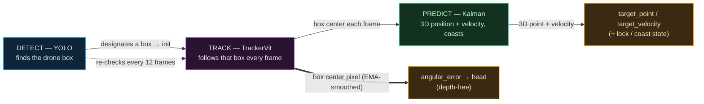
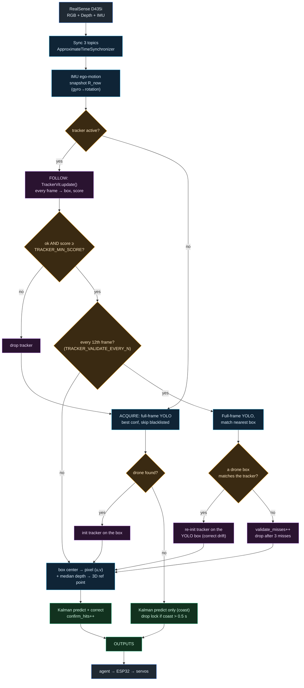
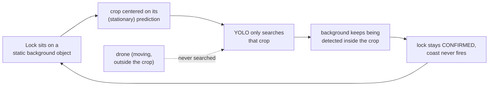

# OrexBot Drone Detection, Tracking & Prediction Pipeline

How a camera frame becomes a head-control command — and, just as importantly, **which of
the three tools is doing what.** If this area feels fuzzy, read §1 (the mental model) and
§2 (the real runtime flowchart) first; everything after is detail and tuning.

> Everything below runs in `vision_node.py` (class `vision_tracking`). Constant names
> (e.g. `TRACKER_MIN_SCORE`) are the module-level tunables at the top of that file.

---

## 1. The mental model — three tools, three different jobs

The single most useful thing to internalize: **detection, tracking, and prediction are
three separate jobs, done by three different tools.** Most confusion comes from expecting
one of them to do another's job.

| Tool | Job | Answers the question | Strength | Weakness |
|------|-----|----------------------|----------|----------|
| **YOLO** (Ultralytics) | **DETECT** | "Is there a drone, and where — from scratch?" | knows what a drone *looks like*; recovers with no prior | flickery frame-to-frame, slower, no notion of "the same drone" |
| **TrackerVit** (OpenCV) | **TRACK** | "Follow *this specific* drone, every frame" | fast, smooth, follows appearance through YOLO flicker & motion | drifts over time; follows whatever you init it on (even the wrong thing); can't acquire on its own |
| **Kalman filter** (OpenCV) | **PREDICT** | "Where is it in 3D, and where is it heading?" | smooths noise, coasts through gaps, gives velocity | only as good as the measurements fed in |

Two things worth noticing right away, because they surprise people:

1. **The head is aimed by the *tracker's pixel*, not the Kalman 3D point.** The yaw/pitch
   error the ESP32 receives is computed straight from the (smoothed) box-center pixel —
   depth never enters it, so depth noise can't twitch the head. See §4.
2. **The Kalman filter feeds the HUD and the lock/coast logic, not the head aim.** Its 3D
   position + velocity drive `target_point`/`target_velocity` (the HUD's reticle and
   motion arrow) and decide when a lost target is "coasted" vs. declared LOST.

---

## 2. The real runtime flowchart (per synchronized frame)

This is the actual control flow in `sync_callback`. It is a two-state machine —
**FOLLOW** (a tracker is live) vs. **ACQUIRE** (no tracker, hunt full-frame with YOLO).

**Plain-English walk-through of one frame:**

1. **Sync + ego-motion.** Three camera topics are aligned into one RGB+depth+info triple.
   The IMU gyro is integrated (separately, at ~200 Hz) into a rotation `R_cur`; each frame
   snapshots it as `R_now` so head pan/tilt can be subtracted out later — a moving head
   must not look like a moving drone.
2. **FOLLOW (a tracker is live).** `TrackerVit.update()` returns the new box + a 0–1 score.
   - Score too low / lost → **drop the tracker**, fall through to ACQUIRE this same frame.
   - Good score → keep the box. **Every 12th frame**, run a full-frame YOLO pass and try to
     match a real drone box to the tracker; if it matches, **re-anchor** the tracker on the
     YOLO box (kills drift). If YOLO can't confirm it 3 times running, drop the tracker.
3. **ACQUIRE (no tracker).** Run full-frame YOLO, take the highest-confidence drone box that
   isn't blacklisted, and **init the tracker** on it. Nothing found → coast.
4. **Box → measurement.** Whatever box we ended with: its center pixel `(u,v)` feeds the
   head aim; that pixel + robust (median) depth deprojects to a 3D point, rotated into the
   ego-stabilized reference frame, to feed the Kalman filter.
5. **Kalman predict/correct** (or predict-only "coast" if no measurement this frame).
6. **Publish** the outputs (§4) and the head follows.

> **Heads-up — dormant code in the file.** `_compute_search_roi` (the YOLO-on-a-crop "ROI"),
> `_select_measurement` (the validation gate), and the constants `ROI_*`, `GATE_*`,
> `CONFIRM_HITS` still exist near the top of the file, but the tracker-first path **does not
> call the ROI/gate anymore** — TrackerVit replaced them (see §5 for why). `CONFIRM_HITS` is
> still used (lock confirmation). Don't spend time tuning `ROI_*`/`GATE_*`; they're inert in
> the current path.

---

## 3. Each stage: what it hands down, and the symptom if it breaks

| Stage | Input → Output | If it misbehaves, you see… |
|-------|----------------|-----------------------------|
| **Sync** | 3 camera topics → 1 aligned RGB+depth+info | stutter, dropped frames |
| **IMU ego-motion** | gyro → `R_cur` (camera→reference) | head motion shows up as fake drone velocity; HUD arrow flails when the head turns |
| **DETECT (YOLO)** | image → drone boxes + confidence | drone never boxed (missed), or background boxed as a drone (false lock) |
| **TRACK (TrackerVit)** | box + frame → box every frame + score | lock flickers, or the box slides off onto the background (drift) |
| **Deproject** | box center + depth → 3D point (ref frame) | 3D point / range jumps from a depth hole |
| **PREDICT (Kalman)** | measurement stream → smoothed 3D + velocity | jittery HUD reticle, or a "ghost" coasts after the drone is gone |
| **Pixel EMA → aim** | box-center pixel → smoothed yaw/pitch error | head jitters (α too high) or lags (α too low) |
| **Outputs / lock** | filtered state → topics + lock flag | head gets no command, a stale one, or LOCK/SEARCH flashing |

---

## 4. The outputs — what actually leaves the node

Published in `_publish_tracking_outputs`:

| Topic | Type | Source | Consumer |
|-------|------|--------|----------|
| `/head/angular_error` | `Vector3` (rad) | **EMA-smoothed box-center pixel**, depth-free: `x = atan2(u−cx, fx)`, `y = atan2(v−cy, fy)` | ESP32 head control (the aim command) |
| `/head/target_point` | `PointStamped` (m) | Kalman 3D position, rotated back to the camera frame | HUD reticle, RViz (future) |
| `/head/target_velocity` | `Vector3` (m/s) | Kalman 3D velocity, rotated to camera frame | HUD motion arrow |
| `/head/target_locked` | `Bool` | `filter_initialized AND confirm_hits ≥ CONFIRM_HITS` | ESP32 stops slewing when `false` |

**Why the aim is depth-free.** To *center* the head on the drone you only need the
*direction* to it, which the pixel gives you exactly (`atan2(pixel_offset, focal_length)`).
Depth (`z`) would only scale a 3D point you'd then convert back to the same angle — so
feeding depth in just injects RealSense depth noise into the head for no benefit. The pixel
is EMA-smoothed (`PIXEL_EMA_ALPHA`) so the head glides instead of chasing per-frame jitter.

---

## 5. The tuning surface — every live knob and its effect

### DETECT — YOLO
| Knob | Now | Up → | Down → |
|------|-----|------|--------|
| `FULL_CONF` (full-frame acquire threshold) | `0.40` | fewer background false-locks, but drone must be a *strong* detection to acquire | acquires weak/distant drones, more clutter slips in |
| `classes` | `[0]` | (restricts to the drone class — wrong class = nothing detected) | — |
| input size | `640` | bigger = small drones detectable but slower | faster, tiny drones vanish |

*`ROI_CONF` is currently inert (no crop pass runs).*

### TRACK — TrackerVit
| Knob | Now | Effect |
|------|-----|--------|
| `TRACKER_MIN_SCORE` | `0.35` | higher = drops the tracker sooner when unsure (re-acquires cleaner, but flickers on a hard-to-see drone); lower = clings longer (smoother, but can ride the background after the drone's gone) |
| `TRACKER_VALIDATE_EVERY_N` | `12` frames | how often YOLO re-checks/re-anchors the tracker. Lower = drift corrected faster + tighter "is it still a drone?" checks, but more YOLO passes; higher = cheaper, more drift between checks |
| `TRACKER_VALIDATE_MAX_MISSES` | `3` | consecutive failed YOLO confirmations before the tracker is dropped. Higher = tolerates YOLO flicker; lower = sheds a wrong lock faster |
| `TRACKER_MATCH_DIST_FRAC` | `0.15`·width | how close a YOLO box must be to "confirm" the tracker. Bigger = forgiving (accepts a nearby detection); smaller = strict |

### Deproject
| Knob | Now | Effect |
|------|-----|--------|
| `DEPTH_WIN_HALF` | `3` (7×7 median) | bigger window rejects depth-hole outliers but blurs depth at edges |

### PREDICT — Kalman
The measurement noise `R` is **anisotropic and range-adaptive**, not one isotropic value:
pixel-derived X/Y are trusted; depth Z is distrusted more as the target gets farther (the
D435i's depth error grows ~range²). `R` is built in the camera frame and rotated into the
ego-stabilized frame each correction (`_adaptive_meas_noise`), so "distrust depth" stays on
the true optical axis even when the head is turned.

| Knob | Now | Effect |
|------|-----|--------|
| `KF_PROCESS_NOISE` | `0.015` | higher = trusts the *measurement* more → snappier, jerkier 3D/velocity |
| `KF_MEAS_NOISE_XY` | `0.25` | lateral (pixel) variance. Lower = trusts X/Y more (tighter lateral 3D); raise if lateral estimate jitters |
| `KF_MEAS_NOISE_Z_BASE` | `0.5` | depth variance *at the reference range*. Higher = smoother but laggier range |
| `KF_MEAS_Z_REF_M` | `2.0 m` | range where Z noise equals the base; beyond it, Z is trusted less (∝ range²) |
| `KF_MEAS_Z_MAX_FACTOR` | `8.0` | cap on the range inflation, so a very far/garbage depth is distrusted but not infinitely |
| `COAST_TIMEOUT_S` | `0.5 s` | how long a lost target is extrapolated before it's declared LOST and the filter resets |

> **This 3D estimate is the blaster's targeting signal**, published on `/head/target_point`
> (+ `/head/target_velocity`). The head aims via the depth-free pixel (§4); the *arm* consumes
> the filtered 3D position/velocity to aim at the drone's predicted location through the URDF/TF
> tree. That's why depth accuracy here matters even though it never moves the head.

### Head aim smoothing
| Knob | Now | Effect |
|------|-----|--------|
| `PIXEL_EMA_ALPHA` | `0.2` | lower = smoother head, more lag; higher = more responsive, more jitter. (Measured jitter at 0.2: yaw ≈0.35°, pitch ≈0.20° 1σ.) |

### Lock confirmation
| Knob | Now | Effect |
|------|-----|--------|
| `CONFIRM_HITS` | `3` | consecutive good measurements before `target_locked` latches true — stops a one-frame false positive claiming a lock |

---

## 6. Why the design is shaped this way (the history)

This section is background — *why* the tracker-first design exists. The problems below are
already solved by §2; this explains the reasoning so future changes don't reintroduce them.

### 6a. The ROI trap (the original bug, now designed out)

The first design ran YOLO only inside a small crop around the last prediction. That crop is
what made small drones detectable — but it created a feedback loop that defended a *wrong*
lock:

The tight crop that helps detection is exactly what strands you when the target is
elsewhere. **TrackerVit removes this**: instead of betting the drone stayed inside a
predicted box, the tracker follows the drone's *actual* appearance across the full frame,
and YOLO re-acquires full-frame the moment the tracker is dropped.

### 6b. Motion-based designation (built, then superseded)

Because ego-motion is compensated, a static background object has ~0 reference-frame
velocity while a flying drone does not — a real discriminator. A "drop a lock that stays
stationary too long, then blacklist that spot" rule (`STATIC_SPEED_MPS`, `STATIC_TIMEOUT_S`,
`BLACKLIST_S`) was added to shed background locks.

**It's now disabled while the tracker is active** (`_check_static_lock` returns early when
`_vit_ok`): the tracker + YOLO re-validation is a better clutter rejector, and motion-based
dropping would falsely shed a *hovering* drone — that was the "lock/search flashing on a
still drone" you saw. The blacklist is still consulted during ACQUIRE.

### 6c. Where each tool ended up

- **TrackerVit replaced the crop-ROI** as the per-frame follower (§6a).
- **YOLO became the acquirer + periodic validator**, not the per-frame detector — it
  designates the drone, re-anchors the tracker (correcting drift), and takes over cold when
  the tracker is dropped.
- **Kalman is unchanged in spirit** — it filters the box center into a smooth 3D
  position/velocity for the HUD and coast/lock logic. (The head aim, separately, uses the
  depth-free pixel — §4.)
- **CSRT** was the original plan but isn't in this OpenCV build (no contrib module);
  TrackerVit is a stronger transformer tracker that also reports a confidence score, which
  the drop/re-validate logic relies on.

---

## 7. Watching it work (log lines to grep)

- `Acquired target conf=…; tracker initialized.` — ACQUIRE fired (cold pickup).
- `[track(0.xx)] ref=(…)` — FOLLOW is running; the number is the tracker score.
- `[track+yolo(0.xx)]` — a periodic YOLO re-anchor just landed.
- `Tracker validation miss n/3` → `Tracker unconfirmed by YOLO; dropping.` — tracker lost YOLO
  confirmation; it will re-acquire full-frame.
- `Target lost: no detection for …s (> 0.5s coast limit); halting output.` — coast timeout.
- `Target lock -> LOCKED` / `LOST` — the `target_locked` edge the head watches.

**Quick triage:**
- *Flickers LOCK/SEARCH on a near-still drone* → raise `TRACKER_MIN_SCORE` tolerance (lower it),
  or increase `PIXEL_EMA` smoothing; confirm §6b static-drop is disabled (it is, when the ViT
  model is present).
- *Head jitters* → lower `PIXEL_EMA_ALPHA`. *Head lags a fast drone* → raise it.
- *Rides the background after the drone leaves* → raise `TRACKER_MIN_SCORE`, lower
  `TRACKER_VALIDATE_EVERY_N` (validate more often).
- *Never acquires a distant drone* → lower `FULL_CONF`, or fine-tune the model on real footage.
